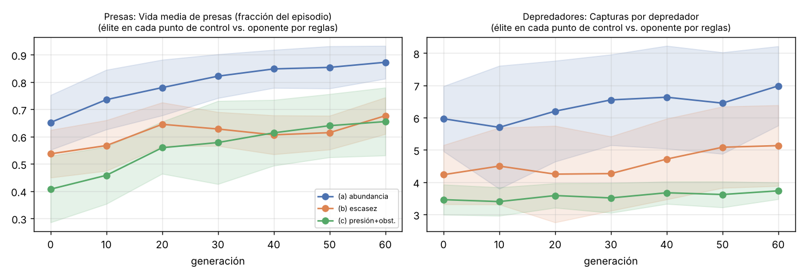
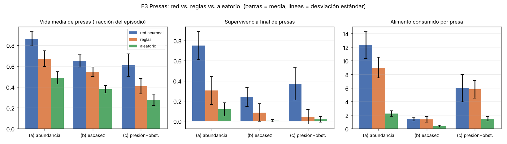
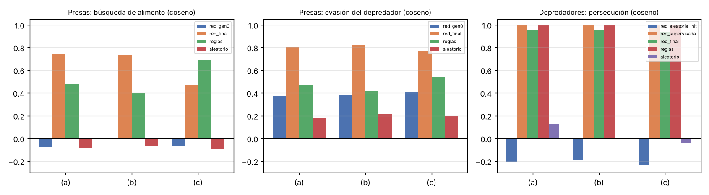

# 1. Problema

Se construyó un ecosistema 2D con dos poblaciones de agentes autónomos —presas y depredadores— cuyas
decisiones de movimiento salen de una red neuronal multicapa propia de cada especie. La pregunta que
orienta el trabajo es **en qué condiciones estos agentes desarrollan búsqueda, persecución y evasión que
mejoran su desempeño frente a estrategias sin aprendizaje**. Para responderla no basta con ver la
simulación: se midió el rendimiento (supervivencia, capturas, alimento, energía, tiempo hasta captura) y
también el comportamiento (hacia dónde se mueve cada agente respecto a lo que percibe), en tres escenarios,
con semillas registradas y contra dos referencias (reglas y aleatoria).

# 2. Arquitectura de la solución

## 2.1 Entorno

Arena cuadrada de 100 × 100 con paredes, 20 presas, entre 2 y 5 depredadores, hasta 60 plantas y hasta 6
obstáculos circulares. Cada episodio dura como máximo 400 pasos y termina antes si no quedan presas.

| Regla | Presa | Depredador |
|---|---|---|
| Velocidad máxima por paso | 1,0 | 1,15 |
| Radio de percepción | 25 | 30 |
| Gasto de energía por paso | 0,002 + 0,003·v² | 0,002 + 0,0045·v² |
| Ganancia | +0,30 por planta | +0,50 por presa capturada |
| Otras | come a < 2 unidades | captura a < 2 unidades; 20 pasos de digestión |

Las plantas rebrotan con probabilidad fija por paso. Un agente con energía ≤ 0 muere. Los obstáculos
expulsan al agente hacia su borde. El simulador es vectorizado: corre cientos de mundos en paralelo con
NumPy, lo que hizo posible entrenar 6 modelos y evaluar más de 4 000 episodios en menos de una hora.

| Escenario | Plantas | Rebrote | Depredadores | Obstáculos |
|---|---|---|---|---|
| (a) abundancia, pocos depredadores | 60 | 0,02 | 2 | 0 |
| (b) escasez de alimento | 15 | 0,005 | 2 | 0 |
| (c) presión de depredación + obstáculos | 60 | 0,02 | 5 | 6 |

## 2.2 Redes neuronales

Cada especie tiene su propia red **14 → 16 → 16 → 2**, con tanh en todas las capas (562 parámetros). La
salida (vx, vy) es el vector de movimiento: su norma se recorta a 1 y se multiplica por la velocidad
máxima. No hay ninguna regla que corrija esa salida; `scripts/check.py` verifica que con los pesos en
cero los agentes no se mueven y que cambiar un solo sesgo de salida desplaza a todas las presas.

**Entradas de la presa:** dirección unitaria (2) y distancia (1) a la planta disponible más cercana, ídem
al depredador más cercano y al obstáculo más cercano; energía; posición normalizada (2); señal de exploración
(cos θ, sin θ). **Entradas del depredador:** dirección y distancia a la presa más cercana; energía; indicador de
digestión; dirección al otro depredador más cercano (2); posición (2); obstáculo (3); exploración (2). Si
no hay nada dentro del radio, la dirección vale (0, 0) y la distancia 1.

## 2.3 Entrenamiento

* **Presas: neuroevolución** desde pesos aleatorios. Algoritmo genético con 30 genomas, 60 generaciones,
  élite de 3, torneo de 3, cruce uniforme y mutación gaussiana (15 % de los genes, σ = 0,1).
* **Depredadores: aprendizaje supervisado + neuroevolución.** Primero se clona al depredador por reglas
  (≈ 33 000 pares observación-acción, retropropagación con Adam, 30 épocas, MSE de 0,11–0,12 a 0,02); luego
  la población parte de esa red y evoluciona igual que la de presas.
* **Coevolución con oponentes mixtos:** cada genoma juega 6 episodios (3 escenarios × {oponente por reglas,
  élite neuronal de la generación anterior}) con las mismas semillas para toda la generación.
* **Aptitud.** Presa: vida media + 0,02 × plantas por presa. Depredador: capturas por depredador + 0,5 ×
  energía final + acecho (cercanía media a la presa, en [0, 1]).

Se entrenaron dos arquitecturas (base 16-16 y reducida 4-4), cada una con tres semillas (11, 22, 33). Los
pesos sí cambian: la élite final de las presas está a una distancia L2 de 7,6–10,8 de la élite inicial, y la
de los depredadores a 6,6–6,7 de la red supervisada (fig. 2 en anexos).

# 3. Decisiones justificadas (resumen)

La bitácora completa (`docs/BITACORA_DECISIONES.md`) desarrolla nueve decisiones con alternativas, evidencia
y criterio. Las de mayor peso fueron:

1. **Percepción por vecino más cercano** (D1) en lugar de estado global o rayos: entradas de tamaño fijo e
   interpretables. Se excluyeron velocidades ajenas, tiempo del episodio y conteos globales.
2. **Dirección unitaria + distancia aparte** (D2): con el vector escalado la dirección se desvanecía al
   acercarse al objetivo. En los pilotos la aptitud de las presas en la generación 10 subió de 0,69 a 0,85.
3. **Señal de exploración como entrada** (D3): la red no tiene memoria; sin ella, los agentes que no veían
   nada se quedaban contra una pared. Añadir ruido por fuera de la red se descartó porque el movimiento
   dejaría de salir solo de la red.
4. **Pre-entrenamiento supervisado del depredador** (D6): evolucionado desde cero capturaba 0,65 veces por
   episodio frente a 10,9 de las reglas (recompensa escasa). Por eso las dos especies tienen configuraciones de
   entrenamiento distintas.
5. **Oponentes mixtos y números aleatorios comunes** (D5): evitan sobreajuste a un oponente fijo y ciclos de
   coevolución, y reducen el ruido al comparar genomas.

# 4. Metodología experimental

**Variables controladas.** En E1–E3 cambia solo el controlador de la especie evaluada; el oponente es siempre
el agente por reglas, y las 30 semillas de prueba por escenario (5000–5029, nunca vistas en entrenamiento) son
las mismas para todas las condiciones. Cada red se evalúa con sus 3 semillas de entrenamiento (n = 90 episodios
por escenario); cada referencia, n = 30. Las diferencias se contrastan con Mann-Whitney bilateral; los valores p
son orientativos porque los 90 episodios provienen de 3 modelos.

| Exp. | Hipótesis | Qué cambia | Qué se mantiene |
|---|---|---|---|
| E1 | El entrenamiento mejora el desempeño frente a la red sin entrenar | red aleatoria → mejor de la gen. 0 → (supervisada) → final | oponente, semillas, escenario |
| E2 | Una red más grande (16-16) supera a una reducida (4-4) | arquitectura | algoritmo, presupuesto, semillas |
| E3 | La red supera a las referencias por reglas y aleatoria | controlador | oponente, semillas |
| E4 | (descriptivo) cómo se comporta el ecosistema red vs. red | ambos controladores | semillas |

Además se midió el **comportamiento**: el coseno entre la acción y la dirección a la planta (búsqueda, cuando no
hay depredador a la vista), opuesta al depredador (evasión) o hacia la presa (persecución), y la fracción del
tiempo junto a una pared (posible conducta de rincón). Coseno 1 = va exactamente hacia allá; 0 = indiferente.

# 5. Resultados

## 5.1 E1 — Antes y después del entrenamiento

| Escenario | Presa: vida media (aleatoria → gen. 0 → final) | Depredador: capturas/depr. (aleatoria → supervisada → final) |
|---|---|---|
| (a) | 0,487 → 0,625 → **0,862** | 0,01 → 5,90 → **6,83** |
| (b) | 0,438 → 0,493 → **0,649** | 0,00 → 4,17 → **5,04** |
| (c) | 0,287 → 0,379 → **0,611** | 0,00 → 3,64 → **3,66** |

Las presas mejoran en los tres escenarios (final vs. gen. 0: p < 10⁻²² en todos). En los depredadores casi todo el
salto lo produce el aprendizaje supervisado; la neuroevolución añade +0,93 capturas en (a) y +0,87 en (b)
(p < 10⁻⁴) y nada en (c) (p = 0,95). La curva de aprendizaje medida contra reglas en puntos de control cada 10
generaciones (fig. 1) muestra que las presas aún no se estabilizan en la generación 60.

{width=95%}

## 5.2 E2 — Arquitectura 16-16 frente a 4-4

| Escenario | Presa: vida media 16-16 / 4-4 (p) | Depredador: capturas 16-16 / 4-4 (p) |
|---|---|---|
| (a) | 0,862 / 0,829 (0,005) | 6,83 / 6,83 (0,78) |
| (b) | 0,649 / 0,613 (< 0,001) | 5,04 / 4,85 (0,15) |
| (c) | 0,611 / 0,602 (0,85) | 3,66 / 3,62 (0,47) |

La red grande da una ventaja pequeña (≈ 0,03) a las presas en (a) y (b) y ninguna a los depredadores. La
variación entre semillas de entrenamiento es del mismo orden (vida media en (c): 0,566–0,663 en la reducida,
0,589–0,625 en la base), así que la arquitectura no es la decisión que más pesa en el resultado.

## 5.3 E3 — Red neuronal frente a referencias

| Escenario | Presa: supervivencia final (red / reglas / aleatoria) | Presa: vida media | Depredador: capturas/depr. (red / reglas / aleatoria) |
|---|---|---|---|
| (a) | **0,750** / 0,303 / 0,117 | **0,862** / 0,671 / 0,486 | **6,83** / 5,95 / 0,00 |
| (b) | **0,239** / 0,085 / 0,003 | **0,649** / 0,544 / 0,379 | **5,04** / 4,13 / 0,02 |
| (c) | **0,369** / 0,042 / 0,017 | **0,611** / 0,408 / 0,277 | 3,66 / **3,70** / 0,00 |

La presa neuronal supera a ambas referencias en todos los escenarios (p < 10⁻⁹). El depredador neuronal supera a
las reglas en (a) (p = 0,003) y (b) (p < 0,001) y empata en (c) (p = 0,34). En el tiempo hasta la primera captura
no hay diferencia entre red y reglas (≈ 52 pasos en (a) y (b), ≈ 25 en (c)).

{width=100%}

## 5.4 Comportamiento: ¿qué aprendieron?

| Medida (coseno medio) | Red gen. 0 | Red final | Reglas | Aleatorio |
|---|---|---|---|---|
| Presa: búsqueda de alimento (a / b / c) | -0,08 / 0,00 / -0,07 | **0,75 / 0,74 / 0,47** | 0,48 / 0,40 / 0,69 | -0,08 / -0,07 / -0,09 |
| Presa: evasión (a / b / c) | 0,38 / 0,38 / 0,40 | **0,80 / 0,83 / 0,77** | 0,47 / 0,42 / 0,54 | 0,18 / 0,22 / 0,20 |
| Presa: fracción del tiempo junto a pared | 0,52 / 0,47 / 0,50 | 0,17 / 0,30 / 0,31 | 0,00 / 0,00 / 0,00 | 0,41 / 0,41 / 0,39 |
| Depredador: persecución (a / b / c) | -0,21 / -0,20 / -0,23 (red aleatoria) | 0,96 / 0,96 / 0,94 | 1,00 / 1,00 / 1,00 | 0,13 / 0,01 / -0,04 |

Antes de entrenar, la presa no se orientaba hacia la comida (coseno ≈ 0). Al final se orienta hacia la planta
cuando no hay peligro y se aleja del depredador cuando lo ve, con más consistencia que la regla escrita a mano.
El coseno de búsqueda de las reglas es bajo porque cerca de las paredes su repulsión domina sobre la dirección a
la comida (medido en (a): fuera de esa franja el coseno es 1,0; dentro, -0,89). El depredador neuronal persigue casi en línea
recta, como su maestro, pero más rápido: velocidad media 0,92 / 0,88 / 0,88 frente a 0,77 / 0,77 / 0,72 de la red
supervisada.

{width=100%}

## 5.5 E4 — Ecosistema completo

Cuando ambas especies usan red, la supervivencia final de presas en (a) es 0,30, igual que reglas vs. reglas
(0,30), aunque la presa neuronal sobrevivía 0,75 frente al depredador por reglas. El depredador neuronal adelanta
la primera captura (36,7 pasos frente a 52,5 de reglas vs. reglas en (a); 17,8 frente a 24,4 en (c)) y logra más
capturas totales en (a) y (b) (13,7 y 11,3 frente a 11,9 y 8,3).

# 6. Discusión

**Respuesta a la pregunta orientadora.** Los agentes neuronales desarrollan búsqueda, evasión y persecución
medibles. Mejoran a las estrategias sin aprendizaje cuando (1) la recompensa es lo bastante frecuente para que la
selección distinga genomas —caso de las presas, cuya aptitud (tiempo vivo) varía en todo episodio—, o cuando se
les da un punto de partida competente —caso del depredador, que sin pre-entrenamiento no aprendió—, y (2) cuando la
ventaja depende de combinar varias señales: la presa neuronal equilibra comer y huir mejor que una regla de
prioridades fija, y por eso su ventaja es mayor en (c), donde ambas presiones coinciden (supervivencia 0,37 vs 0,04).

**Resultados que contradicen lo esperado.**

1. *La neuroevolución no mejoró al depredador en (c) y lo empeoró en energía y supervivencia* (0,41 frente a 0,68
   de la red supervisada). La aptitud premia capturas y acecho; moverse más rápido aumenta ambos en (a) y (b), pero
   en (c) cinco depredadores compiten por las mismas presas y el gasto extra no se compensa. El término de energía
   (peso 0,5) resultó demasiado débil frente a capturas (≈ 3–7 puntos). Es un caso claro de criterio que favorece
   indebidamente una conducta.
2. *La red grande casi no aporta.* Esperábamos una diferencia clara a favor de 16-16; los datos muestran a lo sumo
   0,03 de vida media en presas y nada en depredadores.
3. *La ventaja de la presa no se traslada al ecosistema red vs. red.* La presa neuronal se entrenó la mitad del
   tiempo contra el depredador élite, pero frente al depredador neuronal final rinde como las reglas frente a
   reglas. Ambas especies mejoraron a la vez (dinámica de "Reina Roja"), lo que también explica que la aptitud de
   entrenamiento del depredador sea plana aunque su rendimiento contra reglas suba.
4. *Conducta de pared.* La presa entrenada pasa 17–31 % del tiempo junto a una pared. Reduce las direcciones de
   ataque, pero se mantiene compatible con alimentarse (12,3 plantas por presa en (a) frente a 9,0 de reglas).

**Escasez (b).** Es el escenario donde la red gana menos en alimento (1,42 vs 1,36 plantas por presa): la mejora
de supervivencia viene de la evasión, no de encontrar más comida. Con 15 plantas que rebrotan lento el límite lo
pone el entorno.

# 7. Fallos y limitaciones

* **El depredador evolucionado desde cero no aprendió** en los pilotos (documentado en `docs/PILOTOS.md`); el
  resultado final depende del pre-entrenamiento supervisado, de modo que parte de su comportamiento es heredado de
  la regla.
* **Entrenamiento no convergido:** la curva de presas sigue subiendo en la generación 60.
* **Pesos de la aptitud fijados a mano** y no explorados sistemáticamente.
* **Percepción simplificada:** solo el vecino más cercano de cada tipo y sin oclusión por obstáculos.
* **Independencia estadística parcial:** 90 episodios de 3 modelos; solo 3 semillas de entrenamiento.
* **Sin reproducción:** no se estudia el equilibrio poblacional de largo plazo.
* La referencia por reglas tiene una debilidad conocida (oscila en la franja junto a las paredes); una regla mejor
  podría reducir la ventaja de la presa neuronal.

# 8. Recomendaciones

1. **Primera modificación: la aptitud del depredador.** Evidencia: en (c) la neuroevolución subió la velocidad
   (0,72 → 0,88) y bajó energía (0,29 → 0,15) y supervivencia (0,68 → 0,41) sin más capturas. Propuesta: subir el
   peso de la energía a ≈ 2 o premiar la supervivencia del depredador, y repetir E1 en (c) con las mismas semillas.
   Hipótesis verificable: la supervivencia del depredador vuelve a ≥ 0,6 sin bajar las capturas.
2. Más generaciones para las presas (la curva no se ha aplanado) y 5 o más semillas de entrenamiento.
3. Añadir el segundo depredador más cercano a la percepción de la presa, para el escenario (c).
4. Probar el depredador desde cero con un currículo (empezar con presas lentas) para separar lo aprendido de lo
   imitado.
5. Usar 4-4 para el depredador: rinde igual con 92 parámetros en lugar de 562.

# 9. Declaración de uso de herramientas de IA generativa

Se utilizó un asistente de IA generativa (Claude, de Anthropic) para escribir la mayor parte del código
(simulador, red, algoritmo genético, retropropagación, scripts de evaluación y visor), proponer el diseño
experimental y redactar borradores de este informe y de la bitácora.

**Recomendaciones aceptadas tras verificarlas con datos:** dirección unitaria en las entradas, señal de exploración,
pre-entrenamiento supervisado del depredador (todas motivadas por los pilotos fallidos documentados).
**Propuestas descartadas o corregidas:** la primera versión de las entradas (vector escalado), la aptitud del
depredador sin término de acecho y la evolución del depredador desde cero, porque los datos mostraron que no
funcionaban; una prueba de energía en `check.py` que podía pasar siempre se corrigió para que verificara de verdad.
**Validaciones realizadas:** verificación numérica del gradiente de la retropropagación (error 7,6·10⁻¹¹),
reproducibilidad con semillas (dos corridas idénticas), prueba de que la salida de la red controla el movimiento,
prueba de captura y gasto de energía (`python scripts/check.py`), y revisión de cada cifra de este informe contra
`results/RESUMEN_RESULTADOS.md`.

[El equipo debe completar aquí, con sus palabras, qué partes revisó, modificó o reescribió cada integrante.]

# Anexos

* **A. Tablas completas** de E1–E4 con media ± desviación y pruebas: `results/RESUMEN_RESULTADOS.md`,
  `results/tables/*.csv`. Datos por episodio: `results/data/*.csv`.
* **B. Figuras:** aptitud por generación (fig1), cambio de pesos (fig2), pérdida supervisada (fig3), curva de
  aprendizaje (fig4), E1 (fig5), E2 (fig6), E3 (fig7), E4 (fig8), comportamiento (fig9) en `results/figures/`.
* **C. Configuración y semillas:** `config/*.json`; historial por generación con semillas de cada episodio en
  `models/*_history.json`.
* **D. Bitácora:** `docs/BITACORA_DECISIONES.md`. **Pilotos:** `docs/PILOTOS.md`.
